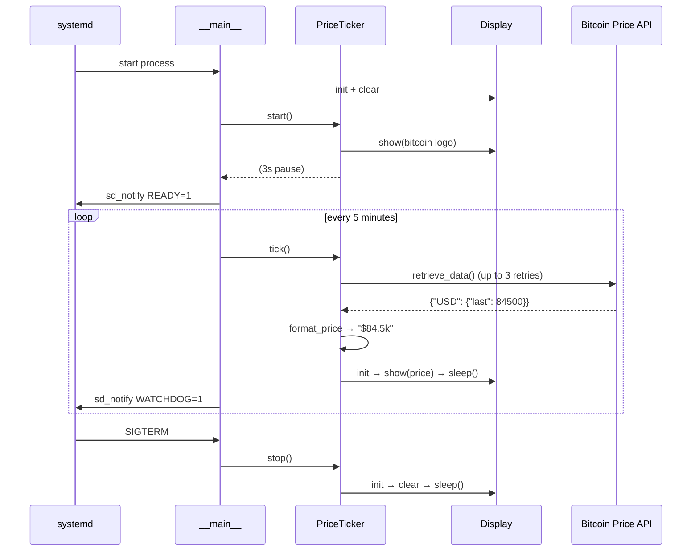

# Bitcoin Price Ticker


[](https://sonarcloud.io/project/overview?id=janrothen_btc-ticker)
[](https://sonarcloud.io/project/overview?id=janrothen_btc-ticker)
[](https://sonarcloud.io/project/overview?id=janrothen_btc-ticker)
[](https://sonarcloud.io/project/overview?id=janrothen_btc-ticker)
[](https://www.gitguardian.com)

Displays the current Bitcoin/USD price on a Waveshare 2.13" e-ink display (epd2in13 V2) connected to a Raspberry Pi. On startup it shows a Bitcoin logo, then enters a loop that refreshes the price every 5 minutes. The background alternates randomly between black and white on each refresh.


## Requirements

**Hardware**
- Raspberry Pi (tested on Pi 4 Model B Rev 1.4)
- Waveshare 2.13" e-ink display (epd2in13 V2)

The guide [How to connect a Waveshare E-Ink display to a Raspberry Pi](https://janrothen.github.io/btc-ticker/raspberry-pi-waveshare-epaper-bitcoin-ticker.html) shows how to physically connect the Waveshare 2.13" e-ink display to a Raspberry Pi.

**Software**
- Python 3.13+
- pip dependencies: `requests`, `Pillow` (see `pyproject.toml`)
- Raspberry Pi extras: `gpiozero`, `lgpio`, `spidev`, `waveshare-epd` (installed by `deploy/install.sh`)

## Architecture

### Runtime sequence



## Configuration

All settings live in `config.toml` — there are no secrets or `.env` files required.

```toml
[bitcoin.price]
service_endpoint = "https://blockchain.info/ticker"
currency = "USD"   # currency code returned by the API (e.g. "CHF", "EUR")
symbol = "$"       # symbol shown on the display (e.g. "CHF ", "€")
refresh_interval = 300  # seconds between price refreshes
```

**To display a different currency**, set `currency` to any code the API returns and `symbol` to the label you want shown on screen. For example, to show Swiss francs:

```toml
currency = "CHF"
symbol = "CHF "
```

The `service_endpoint` must return JSON in this shape (the [blockchain.info ticker](https://blockchain.info/ticker) is the default):

```json
{
  "USD": { "last": 84500.0 },
  "CHF": { "last": 75000.0 }
}
```

Any endpoint that returns this structure works as a drop-in replacement.

## Install & run

On the Raspberry Pi, as the user the service should run as:

```bash
git clone https://github.com/janrothen/btc-ticker.git
cd btc-ticker
./deploy/install.sh
```

The installer sets up system packages, SPI, the `gpio`/`spi` groups, the Python venv and the `btcticker` systemd service, and is safe to run again. Run `./deploy/install.sh --help` for options.

**Upgrade:** `git pull && ./deploy/install.sh`

btc-ticker uses gpiozero's lgpio backend; no GPIO daemon is required.

## Development

```bash
python3 -m venv .venv
source .venv/bin/activate
pip install -e ".[dev]"
pytest
```

The mock price client (`src/btcticker/price/mock.py`) is used automatically during tests so no live API or hardware is required to run the test suite.

## Deployment

Run as a systemd service for auto-start on boot and auto-restart on failure.

`./deploy/install.sh` installs and enables the service. See [`deploy/systemd/README.md`](deploy/systemd/README.md) for the manual steps, migrating from pigpio and rollback.

## Troubleshooting

| Symptom | Likely cause |
|---|---|
| `ModuleNotFoundError` for `waveshare_epd` or `lgpio` | Raspberry Pi extras not installed — run `./deploy/install.sh` |
| Installer fails building `lgpio` (compiler or `Python.h` not found) | Missing build dependencies — run `sudo apt install gcc libc6-dev python3-dev`, then rerun `./deploy/install.sh` |
| `PermissionError` on `/dev/spidev0.0` or `/dev/gpiochip0` | User not in the `spi`/`gpio` groups — rerun `./deploy/install.sh`, which adds them and restarts the service |
| Display stays blank after start | SPI not enabled — run `sudo raspi-config` → Interface Options → SPI → Enable |
| Display blank right after the installer enabled SPI | SPI only takes effect after a reboot — run `sudo reboot`, then rerun `./deploy/install.sh` to start the service and finish the pigpio cleanup |
| Price shows as `$0` or `N/A` | API unreachable — check network and `service_endpoint` in `config.toml` |
| Service fails to start with `sd_notify` errors | `Type=notify` in the unit file requires systemd watchdog support; rerun `./deploy/install.sh` to reinstall the unit |
| Service fails after migrating from pigpio | Check `journalctl -u btcticker -n 50`; to go back, follow [Rollback](deploy/systemd/README.md#rollback) |
| `waveshare_epd` import fails | Package installed from wrong commit — rerun `./deploy/install.sh` |

## Contributing

Found a bug or have an idea? Open an issue or send a PR.
Run `pytest` before submitting and keep changes focused.

## License

MIT © Jan Rothen — see [LICENSE](LICENSE) for details.
